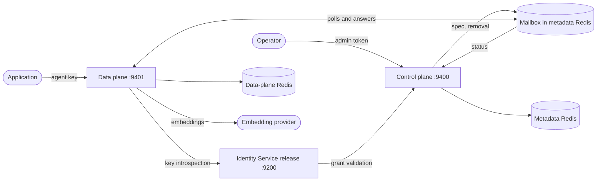

# Redis Intent Router Helm chart

On-prem chart for Redis Intent Router. It deploys two independently scalable
services on the shared `redis-iris-onprem-lib` workload helpers and connects
them to a separately installed Iris Identity Service release (see
[Connecting to the Identity Service](#connecting-to-the-identity-service)); it
deploys no Identity Service itself. It deliberately does not deploy Redis,
issue TLS certificates, generate license material, or create ingress
resources. It can lookup-generate the control-plane admin and internal tokens
using the same retained-Secret contract as the other Iris on-prem charts.
Redis, license, certificate and ingress ownership remain platform decisions.



- **Control plane** owns Router records and converges the data plane onto them.
  The two planes never call each other: the control plane writes each Router's
  desired spec into a small mailbox in its metadata Redis and reads back the
  status the data plane publishes there.
- **Data plane** stores intents and examples, and serves matching. Callers
  authenticate with an agent key granted on specific Routers (`read`, `write`
  or `full`); the data plane introspects each key at the Identity Service.
- **Identity Service** (a separate release) mints and introspects agent keys.
  Before it stores a grant it asks the control plane's grant-validation
  callback whether the Router exists.

## Observability

Scrape `/metrics` on every control-plane and data-plane pod (default ports 9400
and 9401). The data plane's vector index adds `iris.intent.index.operations` and
`iris.intent.index.duration`, labelled by operation and outcome only; labels never
carry a Router, intent, query or vector.

To send spans to a trusted local OTLP/gRPC collector:

```yaml
tracing:
  enabled: true
  otlpGRPCEndpoint: otel-collector.observability.svc:4317
```

Tracing is off by default. The chart does not install a scraper, collector or
analytics store. The shared exporter uses plaintext gRPC to the collector, so
use a trusted local hop and secure its upstream export separately. Changing
tracing enablement or the endpoint rolls both roles when using chart-rendered
configuration. With `controlplane.config.existingSecret`, set the equivalent
`opentelemetry` configuration in that Secret and update its checksum instead.

## Prerequisites

- Helm 3 and a Kubernetes cluster. Local validation uses KinD; a supported EKS
  and Kubernetes version matrix is not yet qualified.
- Two physically distinct Redis deployments. The control plane's metadata Redis
  holds Router records and the mailbox. The data plane's Redis must run vector
  search (see [Storage](#storage)). The services reject aliased endpoints. The
  chart's KinD gate validates `redis:8` for both.
- Two explicitly tagged images: Intent Router control plane and data plane.
- An `iris-identity-service` release that knows the `intent` product, with the
  Intent entries registered, and the data plane's runtime credential Secret (see
  [Connecting to the Identity Service](#connecting-to-the-identity-service)).
  No published Identity Service release carries the `intent` product yet; until
  one does, install the `identity-service/helm` chart and image built from the
  same commit, as the KinD gate does.
- An Intent Router license Secret. The control-plane admin and internal tokens
  may be generated by the chart or supplied as distinct Secret/key references.
- An explicitly configured embedding model and, for any provider but `noop`,
  its private client configuration.
- Network reachability; use authenticated, certificate-verified TLS for
  production dependencies, not only when enabling the FIPS profile.

The chart reads existing storage, license, inference and optional CA Secrets.
Start from
[`examples/basic/prerequisites.example.yaml`](examples/basic/prerequisites.example.yaml),
substitute values through your secret manager, and never commit the rendered
secrets. The storage Secret's overlays supply Redis URLs to each plane; the
Identity Service's metadata Redis belongs to its own release (`metadata.*`), so
use a separate, least-privileged Redis user even when it shares the physical
metadata deployment.

Every existing-Secret reference has an optional checksum value. Set it to a
stable digest of the referenced Secret payload when the Secret name stays the
same across rotations. A changed checksum updates the pod template and rolls
only the workloads that consume that Secret:

```yaml
storage:
  existingSecretChecksum: "<sha256-of-storage-secret-data>"
license:
  existingSecretChecksum: "<sha256-of-license-secret-data>"
controlplane:
  adminToken:
    existingSecretChecksum: "<sha256-of-admin-token>"
```

The same contract is available for the inference Secret, the private CA
(`tls.caCertSecretChecksum`), the control-plane internal token, the
control-plane config Secret and the data plane's Identity Service credential
(`identityService.credential.existingSecretChecksum`). Store only the digest in
values, never the Secret material. If a Secret controller already rolls
consumers on rotation, these checksum fields may remain empty.

## Install

These commands install from a repository checkout. First install the
[Identity Service release](#connecting-to-the-identity-service), provide
loadable images, create the prerequisite Secrets, and replace the example's
placeholder image tags and credentials.

```bash
helm repo add redis-ai https://helm.redis.io/ai --force-update
helm dependency build intent/helm
helm lint intent/helm -f intent/helm/examples/basic/values.yaml
helm upgrade --install intent intent/helm \
  --namespace redis-ai --create-namespace \
  -f intent/helm/examples/basic/values.yaml \
  --set tests.enabled=true
helm test intent --namespace redis-ai
```

The chart pins `redis-iris-onprem-lib` 0.3.0 from `https://helm.redis.io/ai`.
Run `helm dependency build intent/helm` before linting, rendering or local
installation. Dependency resolution also works when the package workflow copies
the chart outside this repository. To iterate on the library itself, use
`task onprem-lib:dev:on` / `dev:off` (see the repo `AGENTS.md`).

Install-time validation requires a tenant, non-empty image tags, storage and
license Secret references, an explicit one-model list, the Identity Service URL
and data-plane credential, plus either a generated or existing Secret for each
control-plane token. It refuses to mount the same Secret key as two credential
roles. Operators must keep all resolved credential values distinct, even with
differently named Secrets. Rendering fails with a named message when a required
value is missing.

Services default to ClusterIP:

- Control plane on `9400`, for approved administrators and Identity Service
  grant validation.
- Data plane on `9401`, for application callers.

## Connecting to the Identity Service

The **Iris Identity Service (IdS)** mints Intent agent keys and answers the data
plane's key-introspection calls. This chart deploys none: install the
[`iris-identity-service`](../../identity-service/helm/README.md) chart as its
own release, then connect this release to it. Intent grants are scoped to a
Router (`resourceType: intent-router`).

Neither chart reads the other's values or checks them against its own. Keeping
the two releases consistent is the deployment automation's job. The end-to-end
KinD harness (`task test:identity:integration FLOW=intent`) proves that a
consistent pair works; `helm test` does not.

### Two-step install

The tested layout puts both releases in one namespace, because both mount the
shared Secrets. With the Secrets from
[`examples/basic/prerequisites.example.yaml`](examples/basic/prerequisites.example.yaml)
and the Identity Service metadata Secret in place:

1. Install the Identity Service release with the Intent entries from
   [Product contracts](#product-contracts):

   ```bash
   helm install iris-identity-service redis-ai/iris-identity-service \
     --namespace redis-ai -f values-ids.yaml
   ```

2. Install this chart with the connection values:

   ```yaml
   tenantId: default
   dataplane:
     identityServiceBaseURL: http://iris-identity-service:9200
   identityService:
     # The in-cluster Service speaks http; refused under fips.
     allowInsecureTransport: true
     credential:
       existingSecret: intent-dp-credential
   controlplane:
     internalToken:
       existingSecret: intent-controlplane-internal
   ```

[`examples/basic/values.yaml`](examples/basic/values.yaml) is a complete values
file for this layout.

### Connection values

| Key | Default | Purpose |
| --- | --- | --- |
| `dataplane.identityServiceBaseURL` | `""` | The Identity Service release's URL. The data plane introspects agent keys there. Required. Must be `https://` unless `identityService.allowInsecureTransport=true`. |
| `identityService.allowInsecureTransport` | `null` (false) | Accept an `http://` Identity Service URL, for example the in-cluster Service. Refused under the fips profile. |
| `identityService.credential.existingSecret` | `""` | The data plane's runtime credential (`intent-dp`), mounted at `/etc/identity-service/runtime/intent-dp/token`. Required. |
| `identityService.credential.secretKey` | `token` | Key in that Secret. |
| `identityService.credential.existingSecretChecksum` | `""` | Set to roll the data plane when the Secret's content changes. |
| `controlplane.internalToken.existingSecret` | `""` | The control plane's internal token, which the Identity Service release presents to the grant validator. |

The Intent data plane always authenticates agent keys, so the URL and
credential are required in every configuration. The data-plane config is fully
chart-rendered; there is no introspection block to set by hand. The control
plane makes no call to the Identity Service: it only answers the grant
validator's callback, so it needs no Identity Service URL or credential.

`identityService.*` holds only `allowInsecureTransport` and `credential`: the
schema rejects any other key, and rejects `storage.identityServiceKey`.

### Workload values

| Key | Default | Purpose |
| --- | --- | --- |
| `controlplane.replicaCount`, `dataplane.replicaCount` | `1` | Replicas of each plane. Both planes are safe to run on several replicas: the reconcile loop and the mailbox sync are level-triggered and decided by compare-and-swap. |
| `dataplane.strategy` | `{}` | The data-plane Deployment's `spec.strategy`, rendered verbatim when set. redis-iris fixes it to `RollingUpdate` with `maxUnavailable: 0`, `maxSurge: 1`. |
| `podDisruptionBudget.enabled` | `false` | A PodDisruptionBudget (`maxUnavailable: 1`) for each plane above one replica. redis-iris turns it on. |
| `controlplane.image.pullPolicy`, `dataplane.image.pullPolicy` | `IfNotPresent` | Image pull policy of each plane. The image tag defaults to the chart version; an empty tag is refused. |
| `controlplane.service.type`, `dataplane.service.type` | `ClusterIP` | Kubernetes Service type of each plane. |
| `serviceAccount.create`, `serviceAccount.name`, `serviceAccount.annotations` | `true`, `""`, `{}` | The ServiceAccount both planes run as. An empty name uses the release's. |
| `podSecurityContext` | non-root user and group `65532`, `RuntimeDefault` seccomp | Pod-level security context of both planes. |
| `securityContext` | no privilege escalation, all capabilities dropped, read-only root filesystem | Container-level security context of both planes. |
| `dataplane.oidc.roleClaims` | `[]` | Token claims the operator's roles are read from. Empty uses the shared defaults, `roles` and `groups`. |
| `auth.oidc.audience` | `""` (`api://redis-iris`) | The audience operator tokens must carry. Used only when `dataplane.oidc` or `controlplane.oidc` is enabled; use the same value in every Iris chart. |

`dataplane.oidc` and `controlplane.oidc` accept only the keys documented here; a
misspelled key is refused at render time instead of being ignored.

### Secret ownership

A Secret that both releases mount is owned by deployment automation and reaches
each chart as `existingSecret` + `secretKey`.

| Secret | Who owns it | Intent value | Identity Service value |
| --- | --- | --- | --- |
| Data-plane runtime credential (`intent-dp`) | Deployment automation | `identityService.credential.existingSecret` | `runtime.serviceCredentials[].existingSecret` |
| Control-plane internal token | Deployment automation (this chart generates `<fullname>-controlplane-internal-token` in development only) | `controlplane.internalToken.existingSecret` | `productValidation.products.intent.credential.existingSecret` |
| Control-plane admin token | Deployment automation, or this chart | `controlplane.adminToken.existingSecret` | None |
| Identity Service metadata Redis config | You | None | `metadata.existingSecret` |
| Identity Service Control token | The Identity Service release, or you | None | `control.*` |

Keep every token distinct: the internal token must not reuse the admin token,
and the chart refuses to mount one Secret key as two of its credentials. It
cannot compare values held in differently named Secrets.

### Product contracts

This mirrors the Intent Router entry in
[the Identity Service chart README](../../identity-service/helm/README.md).
The addresses assume this chart installed as release `intent` (fullname
`intent-redis-intent-router`) and an Identity Service release named
`iris-identity-service`. After changing either, `fullnameOverride`, or a
Service port, restate them on both releases.

| Set on this release | Value | Matching Identity Service value |
| --- | --- | --- |
| `dataplane.identityServiceBaseURL` | `http://iris-identity-service:9200` (the release's Service on its `service.port`, default `9200`) | None |
| `identityService.credential.existingSecret` + `secretKey` | The data plane's runtime credential | `runtime.serviceCredentials[]` entry `name: intent-dp`, `subject: intent-dp`, `allowedOperations: [api-key-introspect]`, `allowedProducts: [intent]`, the same `existingSecret` + `secretKey` |
| `controlplane.internalToken.existingSecret` + `secretKey` | The control plane's internal token | `productValidation.products.intent.credential` |
| `controlplane.service.port` | `9400` | `productValidation.products.intent.baseURL`: `http://intent-redis-intent-router-controlplane:9400` |
| `tenantId` | `default` | `runtime.apiKeyTenant.singleTenantID` |

The matching Identity Service values:

```yaml
runtime:
  apiKeyTenant:
    singleTenantID: default
  serviceCredentials:
    - name: intent-dp
      subject: intent-dp
      allowedOperations: [api-key-introspect]
      allowedProducts: [intent]
      existingSecret: intent-dp-credential
      secretKey: token
productValidation:
  products:
    intent:
      baseURL: http://intent-redis-intent-router-controlplane:9400
      credential:
        existingSecret: intent-controlplane-internal
        secretKey: token
```

The Identity Service asks the control plane to validate every grant before it
persists a key, at `/internal/v1/grants/validate`, presenting the internal
token. With chart-rendered configuration the control plane always reads that
token from its mounted file; with `controlplane.config.existingSecret`, include
`auth.internal_token.token_file` in your config Secret.

Every agent key carries a tenant. Set the Identity Service release's
`runtime.apiKeyTenant.singleTenantID` to this chart's `tenantId`, so the keys
it issues belong to the tenant this installation serves. Neither chart can
check that the two values match. If the same release serves other Iris products, they all use one tenant
and the Identity Service values merge into one `serviceCredentials` list and one
`productValidation.products` map.

### Cross-namespace

The Identity Service release can run in another namespace. Then:

- point `dataplane.identityServiceBaseURL` at its fully qualified Service, for
  example `http://iris-identity-service.<identity-service-namespace>.svc:9200`;
- set its `productValidation.products.intent.baseURL` to
  `http://intent-redis-intent-router-controlplane.<namespace>.svc:9400`;
- provision both shared Secrets with the same values in both namespaces, since
  a Pod mounts Secrets only from its own namespace;
- allow the Identity Service pods to reach the control plane on port `9400` and
  the data plane to reach the Identity Service (see
  [`networkpolicy.reference.yaml`](networkpolicy.reference.yaml)).

The KinD harness tests the same-namespace layout only.

### Global fallbacks

`global.security.profile`, `global.imagePullSecrets` and
`global.tls.caCertSecret` are read when this chart's own `security.profile`,
`imagePullSecrets` or `tls.caCertSecret` is empty, matching the Identity Service
chart, so an umbrella chart's single `global` block configures both releases. A
local value wins. Anything else under `global`, except `global.iris`, is ignored.

### Running under redis-iris

When the chart runs as the `intent` dependency of the `redis-iris` umbrella
(`global.iris` is set), the umbrella sets `fullnameOverride: redis-intent-router`
and points `controlplane.adminToken` at `iris-intent-admin-token`. The suite-wide
settings come from `global.iris` (TDD MOD-19479, "Values precedence"):

| Value | Under redis-iris |
| --- | --- |
| `tenantId` | `global.iris.tenantId` (default `default`) |
| `license.existingSecret`, `license.secretKey` | `global.iris.license.*` (defaults `iris-license`, `license.key`) |
| `auth.oidc.audience` | `global.iris.auth.oidc.audience` (default `api://redis-iris`) |
| `dataplane.identityServiceBaseURL`, `identityService.allowInsecureTransport` | the suite's Identity Service, `http://iris-identity-service.<namespace>.svc.<clusterDomain>:9200` |
| `identityService.credential` | `global.iris.secrets.dataplaneServiceCredentials.existingSecret`, else generated `iris-intent-dataplane-credential`; key `intent-dp` |
| `controlplane.internalToken` | `global.iris.secrets.controlplaneInternalTokens.existingSecret`, else generated `iris-intent-internal-token`; key `intent`. The chart generates none |
| `dataplane.oidc`, `controlplane.oidc.enabled` | from `global.iris.auth.oidc` when an issuer is set and `global.iris.auth.roleBindings` map a group for `intent` (or suite-wide): the access-token issuer, JWKS, role claims, the mappings, and the suite tenant as `staticTenantID` |

Leave these unset: a value that differs fails the render and names the `intent.`
field. Each Deployment mounts only its own credential key. `storage`,
`inference`, `controlplane.requireDatabase` and the image tags stay yours to set,
and a missing one names its `intent.` path. Without `global.iris` nothing changes.

### FIPS and TLS trust

Under the fips profile the Identity Service hop must be TLS, with no opt-out:
`dataplane.identityServiceBaseURL` must be `https://` and the chart refuses
`identityService.allowInsecureTransport=true`. Neither chart terminates TLS; put
a mesh, gateway or TLS-terminating proxy in front of the Identity Service. The
data plane and control plane trust `tls.caCertSecret` (or
`global.tls.caCertSecret`) for that URL, on top of the system CAs.

The validator hop is configured on the Identity Service release: under fips its
`productValidation.products.intent.baseURL` must be an `https://` control-plane
endpoint, trusted through that release's own `tls.caCertSecret`. Set
`security.profile` (or `global.security.profile`) on both releases.

## Credentials

Two tokens are chart-managed, each guarding a different surface. Both default
to `autoGenerate: true`: the chart creates a random Secret, keeps it across
upgrades (`helm.sh/resource-policy: keep`) and never rotates it. A non-empty
`existingSecret` takes precedence. Set `autoGenerate: false` when platform policy
requires BYO credentials. Use existing Secrets for offline rendering or GitOps
systems that do not perform live Helm `lookup`; otherwise a fresh render can
generate different credentials.

| Value | Guards |
| --- | --- |
| `controlplane.adminToken` | Operator access to the control-plane API |
| `controlplane.internalToken` | The grant-validation callback; shared with the Identity Service release |

The data plane's Identity Service credential, `identityService.credential`, is
never generated: deployment automation provisions the Secret and registers it on
the Identity Service release. The data plane has no token of its own, because
nothing calls it with one; callers use agent keys.

When you supply `existingSecret`, also set the matching `existingSecretChecksum`
so the pods roll when the Secret changes. The three credential references
(admin, internal, Identity Service) may not name the same Secret key; the render
fails if they do.

## Operator sign-in (OIDC)

Console operators can sign in through your IdP instead of using the admin token.
Agent keys stay enabled. Enable it on the data plane, and on the control plane
if operators also call the control-plane API:

```yaml
auth:
  oidc:
    audience: api://redis-iris   # the aud your IdP puts in the access token
dataplane:
  oidc:
    enabled: true
    issuer: https://idp.example/tenant
    jwksURI: https://idp.example/tenant/keys
    staticTenantID: default      # or tenantIDClaim, never both
    roleMappings:
      iris-admins: product_admin
controlplane:
  oidc:
    enabled: true                # requires dataplane.oidc.enabled
```

The token's tenant must equal `tenantId`. A mapped `product_admin` or
`suite_admin` has full access to every Router of that tenant; a mapped
`operator` or `viewer` is admitted but holds no Router. `roleMappings` is
required and raw role names are never accepted implicitly. The control plane
validates the same tokens against the same issuer. `auth.oidc.audience` is shared
by every Iris service and must not contain a wildcard. The issuer is only compared
with a token's `iss`, so an `http://` issuer needs no opt-in; an HTTP JWKS URI needs
`dataplane.oidc.allowInsecureTransport=true`, which the fips profile refuses.

## Storage

One Secret (`storage.existingSecret`) holds a YAML overlay per service, merged
over the rendered config:

| Key | Content |
| --- | --- |
| `storage.controlplaneKey` | `storage.metadata.urls`: Router records |
| `storage.dataplaneKey` | `storage.redis.urls`: intents, examples, per-Router vector indexes; and `runtime.redis.urls`: the mailbox Redis |

The Identity Service's metadata Redis is not configured here; it belongs to the
Identity Service release.

Give each plane its own data Redis. **The data plane's Redis must run vector
search**: Redis 8, or a database with the Search and Query engine (RediSearch 2.4.3
or later) loaded. The data plane creates one HNSW index per Router (about
`examples x dimensions x 4 bytes` for the vectors plus the graph, so size memory for
the examples you expect), reports a Router ready only once its index is built, and
rebuilds an index that is lost. On a Redis without Search its readiness probe
(`vectorSearch`) fails and a new Router is `FAILED` with a reason that says so. Set
`search-on-timeout` to `FAIL` on that Redis where the platform allows it; the default,
`RETURN`, lets a search that hits the server timeout return partial results.
The data plane also needs `runtime.redis.urls` in its overlay, pointing at the
control plane's metadata Redis; it reads the mailbox stream and writes one status per
Router (the `mailbox-stream`, `mailbox-published` and `runtime-status` key families under
`<storage.keyPrefix>`), and nothing else of the control plane's data is touched.
`storage.maxRoutersPerTenant` bounds the Routers of the tenant (default 128).

### Customer databases

By default every Router keeps its data in the data plane's Redis (`storage.redis`). To let Routers
live in a customer's own Redis, list the databases under `databases:` in **both** overlay keys,
with the same IDs (1-32 letters, digits or hyphens, case-insensitive) and the same URLs:

```yaml
databases:
  customer-a:
    urls: ["rediss://:<password>@redis-a.example:6379"]
```

A Router then names one with `databaseId` when it is created, and never changes it. The control plane only checks
the ID (unknown: 400) and never connects; the data plane connects, and each database needs Search like the default
one. A database may not be the mailbox Redis. URLs can carry a login, so they belong in this Secret, not in values;
changing one is a restart (a changed Secret checksum rolls the pods). Set `controlplane.requireDatabase=true` to
make every Router name one. A Router whose database is unreachable keeps waiting with the reason, then fails at the
provisioning deadline; a serving one answers `503` with `Retry-After` until it returns. See `intent/AGENTS.md`,
"Customer databases".

## Embeddings

`inference.models` lists the deployment's one embedding model as a public,
immutable identity (`provider`, `model`, `dimensions`); the render fails for an
empty list or more than one entry. The control plane serves the same list from
`GET /iris/v1/intent/models`, so the API and the deployment cannot disagree.
Keep the catalog aligned between the control plane and the data plane: the chart
renders it into both. Do not place provider endpoints or credentials in values.

For any provider other than `noop`, set `inference.existingSecret` to a Secret
whose `inference.yaml` (`inference.secretKey`) carries
`embedders_connection_details`; it is mounted into the data plane only:

```yaml
embedders_connection_details:
  openai:
    base_url: https://api.openai.com/v1
    credentials:
      type: static
      api_key: REPLACE_PRIVATELY
```

The data plane embeds through the shared `pkg/inference` client. Each
`embedders_connection_details` entry (`base_url`, `credentials`, optional
`protocol`) serves the Routers whose `vectorSpace.provider` has that name. Keep
the identity in the Secret and in `inference.models` identical. A model or width
change requires a new Router; changing a connection must preserve its vector
space.

The `noop` provider matches by shared words, not meaning, and exists for
development and tests. The chart refuses it unless
`inference.allowLocalModels=true`, and the services refuse it in the production
profile the chart always sets, so it is not usable in a deployed release.

## FIPS

Set `security.profile=fips` (or `global.security.profile`) only when the images
were built with the Go FIPS module and all dependency transport is ready:

```yaml
security:
  profile: fips
dataplane:
  identityServiceBaseURL: https://identity.internal.example
tls:
  caCertSecret: redis-ai-private-ca
```

The chart sets `GODEBUG=fips140=on` in every container. FIPS renders fail unless
`dataplane.identityServiceBaseURL` is an explicit HTTPS endpoint, refuse
`identityService.allowInsecureTransport`, and require HTTPS operator-sign-in
endpoints with `allowInsecureTransport=false`. Set the Identity Service
release's own profile and its HTTPS grant-validator URL there (see
[FIPS and TLS trust](#fips-and-tls-trust)). Use `rediss://` URLs in the storage
Secret, including `runtime.redis.urls` and every `databases` entry. The render
does not check these URLs, because they live in the Secret; the data plane
refuses to start in the FIPS profile if any of them is not `rediss://`. The
optional CA Secret is mounted at `/etc/ssl/custom` in every process.

This is a FIPS-oriented operating profile, not by itself a compliance claim. The
workloads still listen on HTTP; the chart does not provision TLS termination or
a mesh. Supplying HTTPS URLs alone does not create secure service endpoints.

## Images and upgrades

### Upgrade notes

This is the first release of the chart: there is no earlier version to upgrade
from, and no prototype-data migration. Chart `0.1.0` deploys no Identity Service
(an earlier development form that bundled one was never released), so there are
no `identityService.*` image, token or `storage.identityServiceKey` values to
migrate.

The chart pins `redis-iris-onprem-lib` 0.3.0 exactly in `Chart.yaml`. A library
change reaches this chart only when that pin is bumped to a published version
and `helm dependency update intent/helm` refreshes `Chart.lock` and the vendored
archive. `task test:onprem-lib-sync` fails when the pin matches the library's
current version but its content has drifted. Replacing the chart with a
newer one is a normal `helm upgrade`; Redis records and indexes are external to
the release.

### Image and Secret rollouts

From the repository root, `task intent:build:docker` builds both on-prem
images. The `onprem-dev` Dockerfile targets (used by the KinD flow) accept a
development license; the production `onprem` targets require the
`LICENSE_PUBLIC_KEY_B64` BuildKit secret and embed that verifier key, and do
not start without a valid license. Runtime configuration is always mounted; no configuration or
customer secret is baked into an image.

Roll forward and backward with immutable image tags; each image tag defaults
to the chart version, and an empty tag is refused. After rotating a mounted credential or storage
Secret, update its `existingSecretChecksum` and run `helm upgrade`; if no
checksum is managed, restart the affected Deployment so startup validation and
long-lived dependencies are re-established against the new material.

Run the package gates with:

```bash
task intent:test:chart
task intent:fips:test:runtime
task intent:test:lifecycle
task intent:test:release-artifacts
task intent:test:onprem-kind
```

Manual dispatch of `intent-onprem-package.yml` accepts an Intent Router version,
which must equal the committed chart version; without one it uses the committed
version. It builds the production images, packages the committed chart, and
creates a seven-day Actions artifact containing image archives, the packaged chart,
SBOMs, the OpenAPI contracts, a component manifest, an image-values overlay and
SHA-256 checksums. It also installs the exact chart archive and images on KinD
against a standalone Identity Service built from the same commit, using a
one-day Intent license signed with `LICENSE_PRIVATE_KEY`. The package
validation does not push an image or chart or create a GitHub release. These
checks do not establish EKS, real-provider, TLS, backup/restore or cross-version
upgrade qualification.

After the desired source is merged to `release/iris-on-prem-vMAJOR.MINOR` (MOD-20421), `intent-onprem-release.yml`
publishes the two Docker Hub images and opens the Enterprise Helm PR. It builds
and publishes no Identity Service image; operators install an
`iris-identity-service` release. See `intent/AGENTS.md`, "Release", for the
ordered steps and what still blocks them.

## Tuning

`dataplane.limits`, `dataplane.match` and `dataplane.search` are copied
verbatim (snake_case keys) into the data-plane config. See
`intent/dataplane/internal/infrastructure/config.go` for the keys and defaults.
Set fractional values such as `match.default_threshold` from a values file;
`--set` turns `0.8` into a string.

`dataplane.search` tunes the vector index: `hnsw.m`, `hnsw.ef_construction`,
`hnsw.ef_runtime`, `query_timeout`, `ready_cache_ttl` and `verify_interval`
(default 60s, at least 5s: how often an idle Router's index is inspected). The
HNSW values shape recall and memory, never correctness. `dataplane.pollInterval`
sets how often the data plane reads the mailbox, and `dataplane.startupBudget`
how long the pass that converges Routers before the listener opens may take;
the chart refuses a budget over 40s (and an empty or zero one, the 60s process default), because the liveness probe restarts the pod 50s after start. `controlplane.reconcile.interval`
and `provisioningDeadline` pace the control plane's reconcile loop.

## Testing

```bash
task intent:test:chart        # lint, package and offline render assertions
task intent:test:chart:lint   # lint only
task intent:test:onprem-kind  # KinD: standalone Identity Service, this chart, smoke
```

`tests.enabled=true` adds `helm test` pods: a readiness probe of both services
and the shared security-profile assertions, with their read-only RBAC. The
profile assertions check the effective profile, including
`global.security.profile`.

`tests/template-render.sh` holds the offline assertions: required inputs, the
Identity Service connection rules, the `global.*` fallbacks, OIDC guards, FIPS
rendering and the schema's rejection of keys this chart does not take.
`tests/values-test.yaml` is its values file.

`networkpolicy.reference.yaml` is a default-deny starting point, including the
allowances for the Identity Service release; replace every `<placeholder>`
before applying it.
