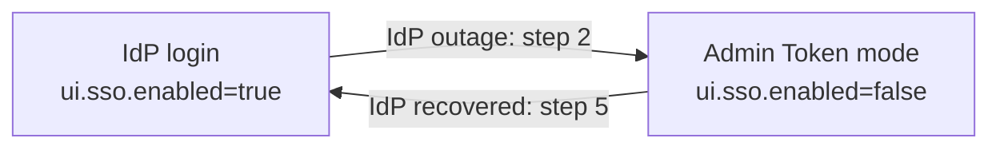

# Break glass: switch the redis-iris UI to Admin Token mode

Use this procedure when operators cannot sign in to the redis-iris UI because the
customer's identity provider (IdP) is down or misconfigured. It switches the UI from
IdP login to Admin Token mode, where operators paste each product's control-plane
admin token, and back again once the IdP recovers (TDD MOD-19479, "Admin Token
fallback mode").

Only the UI changes: its runtime configuration, its gateway configuration, the
gateway rollout, and the ui-auth resources, which Admin Token mode does not run.
Customer data-plane traffic, agent keys, and every Secret are unaffected. Control
planes accept their admin token in both modes.



## Prerequisite, at install time

Keep the installed chart archive next to your values file, so recovery needs
neither `helm.redis.io` nor a different chart version. `NOTES.txt` prints this
command after every install and upgrade:

```bash
helm pull redis-ai/redis-iris --version <installed version>
```

## Switch to Admin Token mode

The examples use release `iris` in namespace `redis-ai`.

1. Read the installed chart version, and use the archive you kept for it. This
   works on every supported Helm (`helm get metadata` needs Helm 3.13 or later):

   ```bash
   V=$(helm list -n redis-ai --filter '^iris$' -o json | jq -r '.[0].chart' | sed 's/^redis-iris-//')
   ls "./redis-iris-$V.tgz"
   ```

2. Disable IdP login. `--reuse-values` keeps every other value, and the pinned
   archive keeps the installed suite:

   ```bash
   helm upgrade iris "./redis-iris-$V.tgz" -n redis-ai --version "$V" \
     --reuse-values --set ui.sso.enabled=false --wait
   ```

   The ui-auth Deployment, Service, NetworkPolicy, and ConfigMap are removed, and
   the gateway rolls with the Admin Token configuration.

3. Read the admin tokens from the Secrets `NOTES.txt` prints (with generated
   credentials: `iris-memory-admin-token`, `iris-playbook-admin-token`,
   `iris-intent-admin-token`, and `iris-identity-service-control-token` for the
   Access & Identity page):

   ```bash
   kubectl -n redis-ai get secret iris-memory-admin-token -o jsonpath='{.data.token}' | base64 -d
   ```

   Lens, from M5 (not in redis-iris 0.3.0): its UI route reaches the Lens data
   plane, which takes a Lens read key instead of an admin token. Mint one for
   `lens-instance:<lens.instance.id>` through Identity Service Control with the
   Control token, named `break-glass-lens` and expiring a few hours ahead
   (`POST /v1/api-keys` with `expiresAt`), so a forgotten key stops working on its own.

   Intent Router, from redis-iris 0.5.0: the console takes `iris-intent-admin-token`
   for the Router list, and asks for an agent key on each Router's Intents tab. List
   the Router ids with the admin token (`GET /iris/v1/intent/routers` on
   `redis-intent-router-controlplane:9400`), then mint one key named
   `break-glass-intent` with the Control token and the same `expiresAt`, with one
   grant per Router (`{"product": "intent", "resourceType": "intent-router",
   "resourceId": "<routerId>", "actions": ["full"]}`). Paste it on each Router.

4. Open the UI (`kubectl -n redis-ai port-forward svc/iris-ui 8080:8080`, or your
   Ingress) and paste each token at its product's prompt.

## Switch back to IdP login

5. After the IdP recovers, repeat step 2 with `ui.sso.enabled=true`:

   ```bash
   helm upgrade iris "./redis-iris-$V.tgz" -n redis-ai --version "$V" \
     --reuse-values --set ui.sso.enabled=true --wait
   ```

   Operators sign in through the IdP again. From M5, also revoke the Lens read key
   and the Intent Router agent key with the Control token: find `break-glass-lens`
   and `break-glass-intent` in `GET /v1/api-keys` and call
   `DELETE /v1/api-keys/{keyId}` for each, so break-glass leaves no credential behind.

## Verification

- CI renders both transitions and asserts that only the UI runtime ConfigMap, the
  nginx ConfigMap, the gateway Deployment, and the ui-auth resources change
  (`iris/helm/tests/template-render.sh`).
- `iris/helm/tests/kind.sh SSO=1 BREAK_GLASS=1` runs steps 1, 2, 4, and 5 against a
  kind install with the test IdP: Admin Token login through the UI while IdP login
  is off, and IdP login again afterwards.
